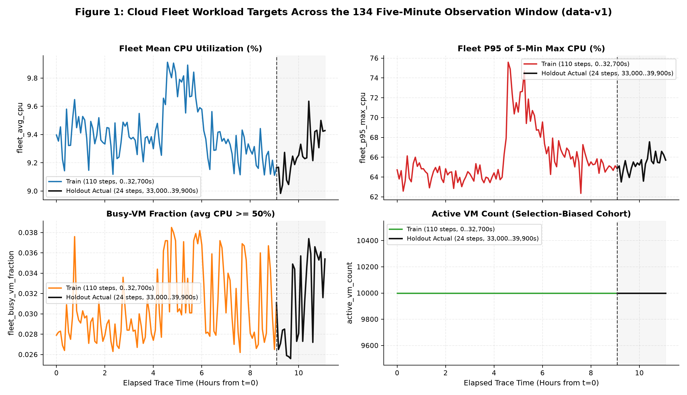
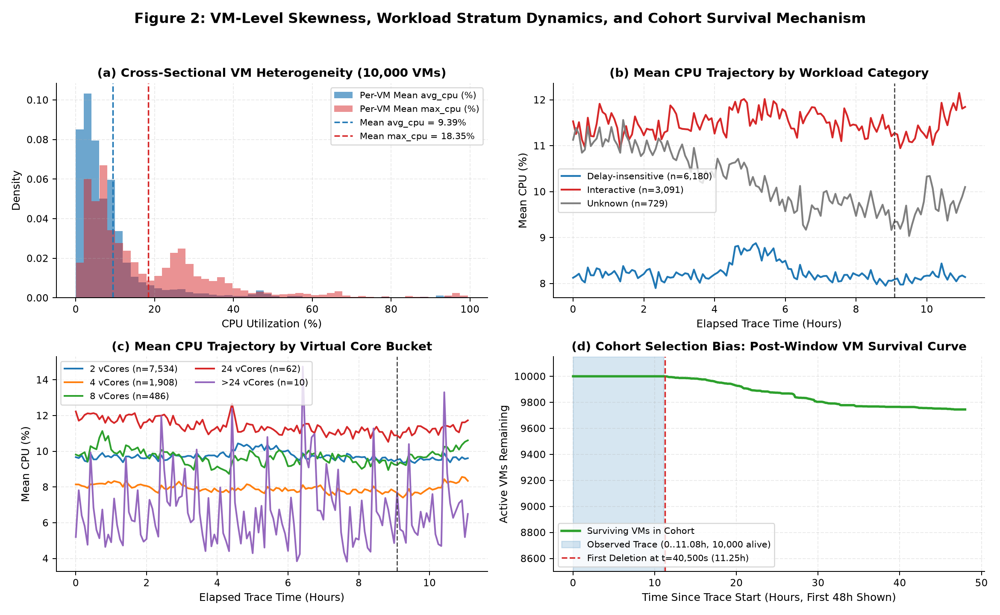
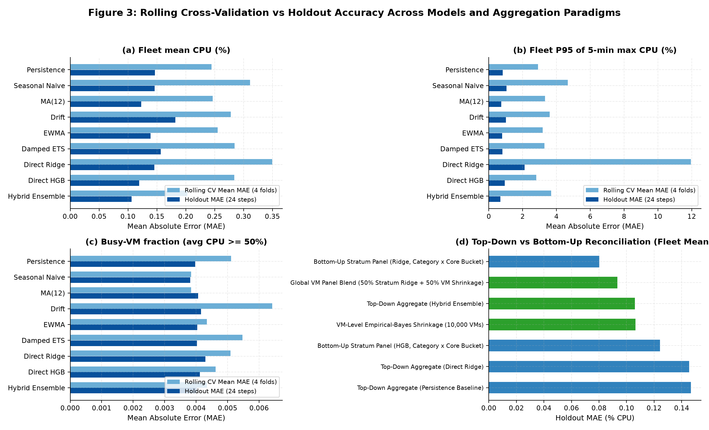
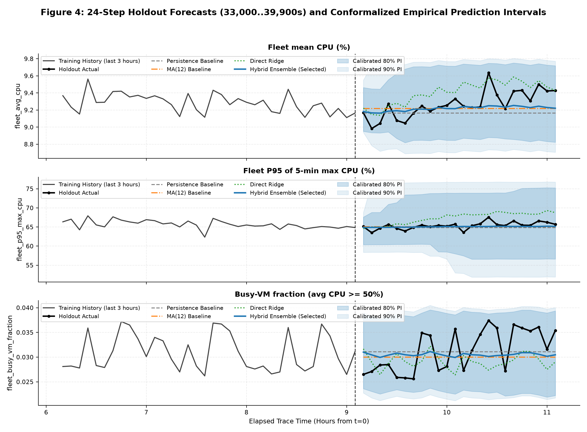
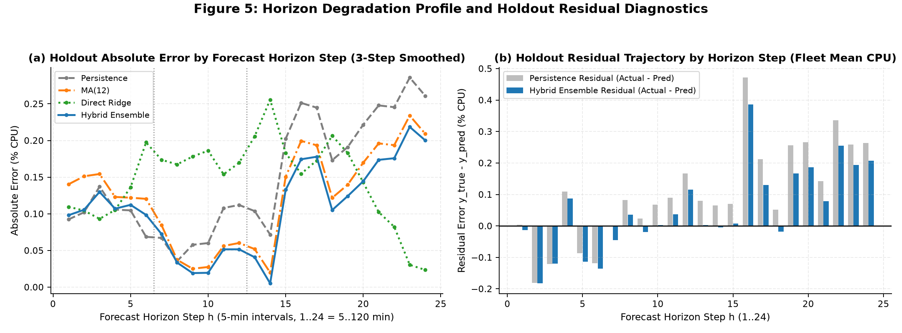
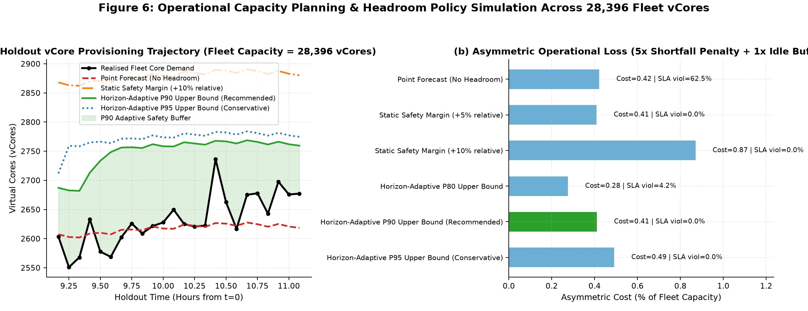

# Cloud Workload Forecasting & Operational Capacity Planning
### Empirical Analysis, Leakage-Free Multi-Horizon Forecasting, and Headroom Policy on Azure Public Dataset V2 (`data-v1`)

---

## 1. Executive Summary

This report addresses the three core questions of the **Cloud Workload Forecasting Challenge (`data-v1`)** on `10,000` Microsoft Azure virtual machines observed across `134` five-minute intervals (`1,340,000` records spanning `0..39,900` seconds, or `11.08` hours):

1. **How predictable is this cloud workload?**
   At the individual VM level, CPU utilization is strongly right-skewed and bursty (`mean avg_cpu = 9.39%`, `median = 5.11%`, `P95 avg_cpu = 37.13%`, `mean max_cpu = 18.35%`, `P95 max_cpu = 65.64%`). However, cross-sectional aggregation across `10,000` VMs cancels idiosyncratic noise: fleet mean CPU (`aggregate_cpu_utilization`) stays within a narrow band (`8.98%–9.91%`, overall mean `9.39%`, std `0.195%`). On the `110`-step training window (`0..32,700s`), autocorrelation is moderate at short lags ($\rho_1 = 0.662$ at 5m, $\rho_3 = 0.664$ at 15m, $\rho_6 = 0.450$ at 30m), weakens by 1 hour ($\rho_{12} = 0.327$), and vanishes by 2 hours ($\rho_{24} = -0.020$; full-series ACF is $0.681, 0.706, 0.521, 0.418, 0.108$ at lags $1, 3, 6, 12, 24$). Meanwhile, **`active_vm_count` is deterministically constant at `10,000`** across all 134 intervals because `data-v1` filters for VMs created at $t = 0\text{ s}$ and deleted at $t \ge 40,500\text{ s}$ (10 minutes *after* the holdout window closes at $t = 39,900\text{ s}$).
2. **How accurately can near-term (2-hour / 24-step) demand be forecast?**
   Using 4 expanding rolling-origin cross-validation folds on the `110` training timestamps (`0..32,700s`) and evaluating once on the `24` holdout timestamps (`33,000..39,900s`), our selected **Top-Down Hybrid Ensemble** (inverse-MAE blend of `Persistence`, `MA(6)`, `Damped ETS`, and `Direct Ridge` learned on inner training folds) ranks **#1 on both Rolling CV (`MAE = 0.2027%` vs. Persistence `0.2445%`, `-17.1%`) and Holdout (`MAE = 0.1061%`, `RMSE = 0.1423%`, `sMAPE = 1.14%`, `MASE = 0.876`, `-27.7%` vs. Persistence `0.1468%`)** for `aggregate_cpu_utilization`. Disaggregating the fleet into `13` homogeneous `vm_category × virtual_core_bucket` strata (**`Bottom-Up Stratum Panel Ridge`**) further reduces holdout error to **`MAE = 0.0802%` CPU** (**`-45.4%` vs. Persistence**). For extension targets, the CV-optimal model differs by series dynamics: `Direct HGB` leads Rolling CV on tail bursts (`fleet_p95_max_cpu` `CV MAE = 2.803%`), while `Seasonal Naive` and `MA(12)` lead on `fleet_busy_vm_fraction` (`CV MAE = 0.00384`).
3. **What should an infrastructure team do with the forecast?**
   Provisioning strictly to the point forecast causes **SLA capacity shortfalls on `62.5%` (15/24) of holdout intervals** (`22.4` vCores mean shortfall). Under a $5:1$ shortfall-to-overprovision penalty ratio, the theoretical Newsvendor critical fractile is $\frac{5}{5+1} = 83.3\%$, motivating our a priori selection of the **`Horizon-Adaptive P90 Upper Bound`** policy across the fleet's **`28,396` provisioned virtual cores**. On the 24-step holdout, `P90` eliminates all standard SLA violations (`0/24` shortfalls) with an average idle buffer of **`+0.411` percentage points (`116.6` vCores)** above actual demand (mean `P90` upper half-width is `+0.462` pp above the point forecast), achieving an asymmetric cost of `0.4105` and cutting wasted buffer capacity by **52.8%** relative to a static `+10%` margin (`247.1` vCores).

| Target Series | Physical Meaning | Best Baseline (CV / Holdout MAE) | Best CV Model (4-Fold MAE) | `Hybrid Ensemble` (CV / Holdout MAE) | Best Hierarchical Model (Holdout MAE) |
|---|---|---:|---:|---:|---:|
| **`aggregate_cpu_utilization`** (`fleet_avg_cpu`) | Mean of VM 5-min `avg_cpu` (%) | `0.2445%` (`Persist.`) / `0.1230%` (`MA(12)`) | **`0.2027%`** (`Hybrid Ensemble`) | **`0.2027%` / `0.1061%`** (`-27.7%` vs Persist.) | **`0.0802%`** (`Stratum Ridge`, `-45.4%`) |
| **`fleet_p95_max_cpu`** | 95th percentile of VM 5-min `max_cpu` (%) | `2.9144%` (`Persist.`) / `0.7269%` (`MA(12)`) | **`2.8034%`** (`Direct HGB`) | `3.6797%` / **`0.6788%`** (`-17.9%` vs Persist.) | — |
| **`fleet_busy_vm_fraction`** | Share of VMs with `avg_cpu >= 50%` | **`0.00384`** (`S.Naive`) / **`0.00381`** (`S.Naive`) | **`0.00384`** (`Seasonal Naive` / `MA(12)`) | `0.00434` / `0.00401` | — |
| **`active_vm_count`** | Distinct active VMs at timestamp $t$ | `0.0000` (`Persistence`) | **`0.0000`** (`All Models`) | **`0.0000` / `0.0000`** | **`0.0000`** (Exact `10,000` VMs) |

---

## 2. Data Understanding, Preprocessing & Cohort Selection-Bias Discovery

### 2.1 Automated Integrity Audit (`reports/data_quality_report.json`)
`cwfc.quality.compute_data_quality_report` audits both `vm_cpu_readings.csv.gz` and `vm_metadata.csv.gz`:
- **Balanced Panel & Exact 300s Cadence:** `1,340,000` rows across `10,000` unique `vm_id`s and `134` timestamps (`0..39,900` seconds = `11.083` hours). All `133` step differences equal `300s` (`0` gaps). The first `110` steps (`0..32,700s`, `9.083h`) form the public training window; the final `24` steps (`33,000..39,900s`, `2.000h`) form the holdout evaluation window.
- **Zero Corruptions:** `0` NaNs, `0` duplicate `(timestamp, vm_id)` pairs, and `0` violations of $0 \le \text{min\_cpu} \le \text{avg\_cpu} \le \text{max\_cpu} \le 100$.
- **Defensive Preprocessing:** For robustness on synthetic smoke datasets, `cwfc.targets` deduplicates `(timestamp, vm_id)` pairs by mean aggregation, ignores missing CPU rows before cross-sectional averaging, and preserves integer-second (`int64`) timestamps end-to-end (fixing the starter template's `pd.to_datetime(..., utc=True)` bug that misread integer seconds `0..39,900` as nanoseconds). Missing timestamps in incomplete training frames are filled via causal forward-fill (`ffill`) and leading-edge backfill (`bfill`) inside `prepare_training_frame`.

### 2.2 Why `active_vm_count` is Constant (`10,000`): The Cohort Selection Mechanism
Inspecting `vm_metadata.csv.gz` explains why `active_vm_count(t) = 10,000` has zero variance:
- Every VM has `timestamp_vm_created = 0` (`vms_created_after_start = 0`) and `timestamp_vm_deleted >= 40,500` (`deleted_timestamp_min = 40,500`, `deleted_timestamp_max = 2,591,400`, `vms_deleted_before_end = 0`).
- Because `data-v1` was curated from VMs surviving at least `11.25` hours (`40,500s`), the first deletion occurs **10 minutes (2 steps) after the holdout window ends at `39,900s`** (Figure 2d). Our `active_vm_count_forecast` detects constant training populations (`nunique == 1`) to return exact persistence, and switches to non-negative rounded Direct Ridge when churn is present.

---

## 3. Exploratory Workload Analysis & Target Formulation

### 3.1 Four Complementary Fleet Targets
Alongside the two required submission columns (`active_vm_count` and `aggregate_cpu_utilization`), `cwfc.targets` tracks two tail/contention extension targets at every 5-minute timestamp $t$:
1. **`active_vm_count`**: Distinct active VMs (`10,000` across all `134` timestamps).
2. **`aggregate_cpu_utilization` (`fleet_avg_cpu`)**: Mean of 5-minute `avg_cpu` across active VMs (`full mean = 9.39%`, `train mean = 9.41%`, `holdout mean = 9.27%`; full range `8.98%–9.91%`, train range `9.11%–9.91%`, holdout range `8.98%–9.64%`).
3. **`fleet_p95_max_cpu`**: 95th percentile of 5-minute `max_cpu` across active VMs (`full mean = 65.83%`, `train mean = 65.93%`, `holdout mean = 65.36%`; full/train range `62.35%–75.58%`, holdout range `63.50%–67.55%`), capturing sub-5-minute tail bursts.
4. **`fleet_busy_vm_fraction`**: Share of VMs with `avg_cpu >= 50.0%` (`full mean = 3.08%`, `train mean = 3.06%`, `holdout mean = 3.14%`; full range `2.56%–3.85%`, train range `2.62%–3.85%`, holdout range `2.56%–3.74%`).

### 3.2 Skewness, Mid-Trace Surge & Segment Heterogeneity
As shown in **Figures 1–2**, three structural regimes govern the trace:
- **Cross-Sectional Skewness & Intra-Interval Bursts (Figure 2a):** Across `1.34M` rows, median `avg_cpu` (`5.11%`) is nearly half the mean (`9.39%`), while mean `max_cpu` (`18.35%`) is nearly **$2\times$ mean `avg_cpu`**, with a mean burst spread (`max_cpu - min_cpu`) of `12.19` percentage points (`peak_to_avg_ratio = 2.01x` in core demand).
- **Mid-Trace Workload Surge & Holdout Mini-Peak (Figure 1):** During the training window, the fleet experiences a synchronized workload wave peaking at **$t = 16,500\text{ s}$ (`4.58h`)**, where `fleet_avg_cpu` reaches **`9.91%`** (`9.912%`) and `fleet_p95_max_cpu` spikes to **`75.58%`** (`fleet_busy_vm_fraction` peaks one step later at `t = 17,100s` at **`3.85%`**). Utilization then troughs at `t = 27,300..32,400s` (`9.11%` CPU) before entering the holdout (`33,000..39,900s`), which dips to `8.98%` at `t = 33,300s` and rises to a late mini-peak of **`9.64%`** (`9.636%`) at **`t = 37,500s` (`10.42h`)**.
- **Category & Virtual-Core Stratification (Figures 2b–2c):**
  - **By `vm_category`:** `Delay-insensitive` VMs (`6,180` VMs, `61.8%`) run coolest and smoothest (`mean CPU = 8.24%`, `std = 0.21%`, range `7.90%–8.88%`, holdout Persistence `MAE = 0.0810%`). `Interactive` VMs (`3,091` VMs, `30.9%`) run hottest (`mean CPU = 11.49%`, `std = 0.26%`, range `10.95%–12.15%`) with **$3.4\times$ higher holdout Persistence error (`MAE = 0.2793%`)**. `Unknown` VMs (`729` VMs, `7.3%`) average `10.23%` CPU (`std = 0.64%`, range `9.04%–11.56%`, Persistence `MAE = 0.3716%`).
  - **By `virtual_core_bucket` & Fleet vCore Capacity:** Across buckets, mean CPU is **`9.72%`** for `2` vCores (`7,534` VMs, `std = 0.24%`), **`7.93%`** for `4` vCores (`1,908` VMs, `std = 0.22%`), **`9.70%`** for `8` vCores (`486` VMs, `std = 0.42%`), **`11.40%`** for `24` vCores (`62` VMs, `std = 0.39%`), and **`6.62%`** for `>24` vCores (`10` VMs, `std = 1.98%`). Mapping buckets `2, 4, 8, 24, >24` to `2, 4, 8, 24, 32` vCores (`cwfc.policy.compute_fleet_core_capacity`) yields **`28,396` total provisioned vCores** ($7,534\cdot 2 + 1,908\cdot 4 + 486\cdot 8 + 62\cdot 24 + 10\cdot 32$). Because `4`-vCore VMs run cooler (`7.93%`) than `2`-vCore VMs (`9.72%`), **core-weighted fleet utilization averages `9.29%`** (`9.291%` full trace; `9.226%` or `2,619.8` vCores on holdout)—slightly *lower* than unweighted `aggregate_cpu_utilization` (`9.388%` full trace; `9.269%` on holdout). Meanwhile, 5-minute peak core demand ($\sum c_i \cdot \text{max\_cpu}_{i,t}/100$) averages **`5,209` vCores** (`2.01x` average core demand).

---

## 4. Forecasting Approach & Feature Engineering

### 4.1 Causal Level-Relative Feature Engineering (`src/cwfc/features.py`)
Because the training window spans only `9.08` hours (`110` steps) and contains a mid-trace surge, raw-level features cause tree models to mis-extrapolate and 24-hour calendar features overfit. At each forecast origin $t_0$, `build_feature_frame` and `to_relative_features` construct a strictly causal vector from rows $\le t_0$:
- **Level-Relative Autoregressive Lags (`LAGS = (1, 2, 3, 6, 12, 24)`):** $\text{lag}_k(t_0) - y_{t_0}$ for $k \in \{1, 2, 3, 6, 12, 24\}$ (`5, 10, 15, 30, 60, 120` minutes; early steps pad with $y_0$).
- **Centered Rolling & EWMA Statistics:** Level-relative rolling means ($\text{roll\_mean}_w - y_{t_0}$) and rolling population standard deviations ($\text{roll\_std}_w$, `ddof=0`) for $w \in \{3, 6, 12, 24\}$ (`15m, 30m, 1h, 2h`); level-relative rolling min and max ($\text{roll\_min}_w - y_{t_0}$, $\text{roll\_max}_w - y_{t_0}$) for $w \in \{6, 12\}$; trailing differences $y_{t_0} - \text{lag}_k(t_0)$ for $k \in \{1, 3, 6, 12\}$; and level-relative EWMAs ($\text{ewma}_s - y_{t_0}$) for spans $s \in \{3, 6, 12\}$.
- **Causal Cross-Sectional Exogenous Covariates:** When present in the aggregate training frame (`prepare_training_frame`), the origin vector includes cross-sectional distribution descriptors at $t_0$: `p90_cpu`, `p95_cpu`, `mean_max_cpu`, `mean_burst_spread`, `std_cpu`, plus the centered 6-step rolling mean of `mean_max_cpu` (`mean_max_cpu_roll_mean_6 - mean_max_cpu`).
- **Horizon Basis & Residual Target:** Direct models predict the displacement $\Delta y_{t_0, h} = y_{t_0+h} - y_{t_0}$ for $h \in \{1..24\}$ and reconstruct $\hat{y}_{t_0+h} = \text{clip}(y_{t_0} + \widehat{\Delta y}_{t_0, h}, 0, 100)$. Pooled multi-horizon models encode step $h$ via `horizon_encoding`: $(h, \sin(2\pi h / H), \cos(2\pi h / H))$.

### 4.2 Baseline Suite (`src/cwfc/baselines.py`) & Candidate Forecasters (`src/cwfc/models.py`)
- **Five Baselines:** (1) `Persistence` ($\hat{y}_{t_0+h} = y_{t_0}$); (2) `Seasonal Naive` ($L = 24$, repeating the last 2 hours); (3) `Moving Average MA(12)` (trailing 1-hour mean, plus `MA(6)` inside the ensemble); (4) `Damped Drift` (24-step slope damped by $\phi = 0.90^h$); and (5) `EWMA` ($\text{span} = 6$).
- **Four Aggregate Candidate Models:**
  1. `Damped ETS` (`damped_ets_forecast`): Additive damped-trend Holt smoothing (`statsmodels` `ExponentialSmoothing`, falling back to `SimpleExpSmoothing` or grid-searched numpy Holt).
  2. `Direct Multi-Horizon Ridge` (`direct_ridge_forecast`): 24 separate `StandardScaler() + Ridge(alpha=10.0)` pipelines (one per horizon $h \in \{1..24\}$, `min_samples_per_horizon = 8`) fit on level-relative origin features (`include_horizon=False`) to predict $y_{t_0+h} - y_{t_0}$.
  3. `Direct Pooled HistGradientBoosting` (`direct_hgb_forecast`): Regularized `HistGradientBoostingRegressor(max_iter=80, max_depth=3, min_samples_leaf=10, l2_regularization=1.0, random_state=42)` pooled across all $(t_0, h)$ pairs with `(origin features, horizon, h_sin, h_cos)`.
  4. **`Hybrid Ensemble` (`hybrid_ensemble_forecast`, Selected Top-Down Model):** Weighted blend of the four components in `HYBRID_COMPONENTS`—**`persistence`, `moving_average_6` (30-min MA), `damped_ets`, and `direct_ridge`**—weighted by continuous inverse inner-backtest MAE ($w_m \propto (\text{MAE}_m + 10^{-9})^{-1}$) evaluated across `4` inner rolling-origin folds (`fold_step = 6`, `min_train = 48`) carved strictly inside `train_df`. On the 110-step training window for `fleet_avg_cpu`, learned weights are `persistence = 0.319`, `damped_ets = 0.240`, `moving_average_6 = 0.236`, and `direct_ridge = 0.205`.
- **Three Hierarchical / Panel Reconciliation Models (`evaluate_reconciliation`):**
  1. **`Bottom-Up Stratum Panel (Ridge / HGB)` (`segment_panel_forecast`):** Maps VMs via `assign_vm_segments` into **`13` strata** (`vm_category | virtual_core_bucket`, merging cells with $< 30$ VMs into `Delay-insensitive|other` [4 VMs], `Interactive|other` [27 VMs], and `Unknown|other` [7 VMs]), appends stratum mean-reversion (`seg_expanding_dev`) and log-size (`seg_log_size`) features, fits a VM-count-weighted global Ridge (`alpha=10.0`) or HGB model across strata, and aggregates bottom-up using exact training-end VM counts.
  2. **`VM-Level Empirical-Bayes Shrinkage` (`vm_shrinkage_forecast`):** Vectorized panel regression across all `10,000` VMs shrinking each VM's last value toward its 12-step recent mean and expanding mean plus global fleet drift (`ridge_lambda = 1e-3`).
  3. **`Global VM Panel Blend`:** $50\%$ `Bottom-Up Stratum Ridge` $+ 50\%$ `VM-Level Shrinkage`.

---

## 5. Time-Aware Validation & Zero-Leakage Verification

### 5.1 Positional Rolling-Origin Cross-Validation (`src/cwfc/validation.py`)
To mirror the 24-step block forecasting task without temporal leakage, `rolling_origin_splits` generates **4 expanding-window folds** on the `110` training timestamps (`min_train_size = 48` [4h], `horizon = 24` [2h], `step = 12` [1h]):
- **Fold 1:** Train `idx 0..47` (`0..14,100s`) $\rightarrow$ Validate `idx 48..71` (`14,400..21,300s`, surge onset & peak at `16,500s`).
- **Fold 2:** Train `idx 0..59` (`0..17,700s`) $\rightarrow$ Validate `idx 60..83` (`18,000..24,900s`, post-peak decline).
- **Fold 3:** Train `idx 0..71` (`0..21,300s`) $\rightarrow$ Validate `idx 72..95` (`21,600..28,500s`, trough transition).
- **Fold 4:** Train `idx 0..83` (`0..24,900s`) $\rightarrow$ Validate `idx 84..107` (`25,200..32,100s`, pre-holdout stabilization).

### 5.2 Automated Anti-Leakage & Contract Gates (`tests/` & `src/cwfc/gates.py`)
Verified by `161` automated tests in `pytest`:
1. **Prefix Causality:** Perturbing rows $t > t_0$ leaves `build_feature_frame(df).iloc[:t0+1]` bitwise identical.
2. **Holdout Perturbation Invariance (`tests/test_no_leakage.py`):** Multiplying all `240,000` holdout VM CPU readings (`33,000..39,900s`) by `10×` produces **byte-for-byte identical** predictions across `cwfc.predict`, `hybrid_ensemble_forecast`, `segment_panel_forecast`, and `vm_shrinkage_forecast`. Only static metadata columns (`vm_category`, `virtual_core_bucket`) are read; full-trace summary columns (`vm_avg_cpu`, `vm_p95_max_cpu`) are never used as features.
3. **Submission Gate (`cwfc.gates.assert_valid_predictions`):** Enforces exact columns, `24` rows, timestamps `33000..39900`, finiteness, and `[0, 100]` bounds (`35` parametrized cases across `19` test functions in `tests/test_gates.py`).

---

## 6. Results vs. Baselines & Hierarchical Reconciliation

### 6.1 Rolling Cross-Validation vs. 24-Step Holdout Benchmark
Table 1 summarizes key models from `reports/tables/aggregate_cv_metrics.csv` and `reports/tables/aggregate_holdout_metrics.csv`. Model selection for `cwfc.predict` is governed by the primary submission target **`fleet_avg_cpu`** (`aggregate_cpu_utilization`), where **`Hybrid Ensemble` ranks #1 on both 4-fold Rolling CV (`MAE = 0.2027%`) and the 24-step Holdout (`MAE = 0.1061%`, `NMAE = 0.7229`, `MASE = 0.8761`)**.

| Target | Model | Family | Rolling CV MAE (4 Folds) | Rolling CV RMSE | Holdout MAE (24 Steps) | Holdout RMSE | Holdout sMAPE (%) | Holdout NMAE (vs Persist.) | Holdout MASE | Holdout Peak MAE ($\ge Q_{75}$) |
|---|---|---|---:|---:|---:|---:|---:|---:|---:|---:|
| **`fleet_avg_cpu`** | `Persistence` | Baseline | `0.2445` ± `0.0868` | `0.2807` | `0.1468` | `0.1848` | `1.585%` | `1.0000` | `1.2119` | `0.4714` |
| **`fleet_avg_cpu`** | `Seasonal Naive` | Baseline | `0.3111` ± `0.0326` | `0.3517` | `0.1464` | `0.1671` | `1.579%` | `0.9974` | `1.2087` | `0.1934` |
| **`fleet_avg_cpu`** | `MA(12)` (1-hr Mean) | Baseline | `0.2468` ± `0.1182` | `0.2764` | `0.1230` | `0.1613` | `1.326%` | `0.8380` | `1.0156` | `0.4196` |
| **`fleet_avg_cpu`** | `Drift (Damped)` | Baseline | `0.2780` ± `0.1447` | `0.3140` | `0.1820` | `0.2206` | `1.971%` | `1.2402` | `1.5030` | `0.5244` |
| **`fleet_avg_cpu`** | `EWMA (span=6)` | Baseline | `0.2553` ± `0.0936` | `0.2906` | `0.1392` | `0.1770` | `1.503%` | `0.9485` | `1.1495` | `0.4570` |
| **`fleet_avg_cpu`** | `Damped ETS` | Candidate | `0.2847` ± `0.1149` | `0.3224` | `0.1567` | `0.1941` | `1.693%` | `1.0672` | `1.2934` | `0.4864` |
| **`fleet_avg_cpu`** | `Direct Ridge` | Candidate | `0.3499` ± `0.2228` | `0.3969` | `0.1455` | `0.1663` | `1.560%` | `0.9912` | `1.2012` | **`0.0648`** |
| **`fleet_avg_cpu`** | `Direct HGB` | Candidate | `0.2842` ± `0.1113` | `0.3188` | `0.1195` | **`0.1408`** | `1.287%` | `0.8142` | `0.9867` | `0.1918` |
| **`fleet_avg_cpu`** | **`Hybrid Ensemble`** | **Selected (on CV)** | **`0.2027` ± `0.0880`** | **`0.2362`** | **`0.1061`** | `0.1423` | **`1.143%`** | **`0.7229`** | **`0.8761`** | `0.3856` |
| **`fleet_p95_max_cpu`** | `Persistence` | Baseline | `2.9144` ± `2.0183` | `3.4377` | `0.8270` | `1.0247` | `1.267%` | `1.0000` | `0.7402` | `2.0466` |
| **`fleet_p95_max_cpu`** | `MA(12)` (1-hr Mean) | Baseline | `3.3168` ± `1.9450` | `3.8030` | `0.7269` | `0.9449` | `1.113%` | `0.8790` | `0.6506` | `1.8482` |
| **`fleet_p95_max_cpu`** | `Direct Ridge` | Candidate | `11.9585` ± `10.3987` | `15.7953` | `2.1108` | `2.3820` | `3.168%` | `2.5525` | `1.8895` | `1.4680` |
| **`fleet_p95_max_cpu`** | **`Direct HGB`** | **CV Best** | **`2.8034` ± `2.0905`** | **`3.3466`** | `0.9506` | `1.1387` | `1.458%` | `1.1495` | `0.8509` | `2.2886` |
| **`fleet_p95_max_cpu`** | `Hybrid Ensemble` | Holdout Best | `3.6797` ± `1.9558` | `4.4971` | **`0.6788`** | **`0.8999`** | **`1.039%`** | **`0.8209`** | **`0.6076`** | **`1.7786`** |
| **`fleet_busy_vm_fraction`** | `Persistence` | Baseline | `0.00511` | `0.00608` | `0.00397` | `0.00421` | `12.72%` | `1.0000` | `1.4558` | `0.00455` |
| **`fleet_busy_vm_fraction`** | **`Seasonal Naive`** | **CV & Holdout Best** | **`0.00384`** | `0.00491` | **`0.00381`** | `0.00494` | **`12.28%`** | **`0.9611`** | **`1.3992`** | `0.00438` |
| **`fleet_busy_vm_fraction`** | **`MA(12)` (1-hr Mean)** | **CV Co-Best** | **`0.00384`** | **`0.00443`** | `0.00406` | `0.00442` | `13.02%` | `1.0233` | `1.4897` | `0.00566` |
| **`fleet_busy_vm_fraction`** | `Hybrid Ensemble` | Candidate | `0.00434` | `0.00512` | `0.00401` | `0.00431` | `12.87%` | `1.0116` | `1.4727` | `0.00512` |

*Metric definitions:* **sMAPE** uses an $\epsilon = 10^{-8}$ denominator guard ($\frac{200|y - \hat{y}|}{\max(|y|+|\hat{y}|, \epsilon)}$) to prevent division-by-zero blowup on sparse segments; **NMAE** scales MAE by Persistence MAE; **MASE** scales by in-sample 1-step naive MAE.

### 6.2 Top-Down Aggregate vs. Bottom-Up Stratum & VM Shrinkage Reconciliation
Table 2 (`reports/tables/reconciliation_comparison.csv`) compares top-down and bottom-up paradigms on `fleet_avg_cpu`:

| Reconciliation Approach | Modeling Granularity | Holdout MAE (% CPU) | Holdout RMSE (% CPU) | Holdout sMAPE (%) | Holdout NMAE | Holdout MASE |
|---|---|---:|---:|---:|---:|---:|
| **`Bottom-Up Stratum Panel (Ridge, Category × Core Bucket)`** | **Segment Bottom-Up (13 Strata)** | **`0.0802`** | **`0.0980`** | **`0.865%`** | **`0.5462`** | **`0.6620`** |
| **`Global VM Panel Blend (50% Stratum Ridge + 50% VM Shrinkage)`** | **Hierarchical Blend** | **`0.0934`** | **`0.1150`** | **`1.007%`** | **`0.6361`** | **`0.7709`** |
| **`Top-Down Aggregate (Hybrid Ensemble)`** | **Fleet Aggregate (1 Series)** | **`0.1061`** | `0.1423` | **`1.143%`** | **`0.7229`** | **`0.8761`** |
| `VM-Level Empirical-Bayes Shrinkage (10,000 VMs)` | VM Bottom-Up (10,000 Series) | `0.1066` | `0.1343` | `1.149%` | `0.7260` | `0.8799` |
| `Bottom-Up Stratum Panel (HGB, Category × Core Bucket)` | Segment Bottom-Up (13 Strata) | `0.1243` | `0.1515` | `1.340%` | `0.8466` | `1.0260` |
| `Top-Down Aggregate (Direct Ridge)` | Fleet Aggregate (1 Series) | `0.1455` | `0.1663` | `1.560%` | `0.9912` | `1.2012` |
| `Top-Down Aggregate (Persistence Baseline)` | Fleet Aggregate (1 Series) | `0.1468` | `0.1848` | `1.585%` | `1.0000` | `1.2119` |

**Why Stratum Bottom-Up Wins (`MAE = 0.0802%`):** Disaggregating into `13` `vm_category × virtual_core_bucket` strata separates fast-reverting `Interactive` workloads from smooth `Delay-insensitive` workloads while expanding the pooled Ridge training set by $13\times$. Because `vm_metadata.csv.gz` is optional under `SUBMISSION.md`, `cwfc.predict` defaults to the metadata-free `Top-Down Hybrid Ensemble` (`MAE = 0.1061%`) while `segment_panel_forecast` provides an additional `24.4%` error reduction whenever metadata is available.

---

## 7. Error & Failure Mode Analysis

### 7.1 Error Decay Across Forecast Horizons (`reports/tables/horizon_decay_metrics.csv`)
Across `Short (h=1..6, 5–30m)`, `Medium (h=7..12, 35–60m)`, and `Long (h=13..24, 65–120m)` holdout buckets (**Figure 5**):
- **Short (`h=1..6`):** Local inertia dominates; `Damped ETS` (`MAE = 0.0997%`), `Persistence` (`0.1034%`), and `Hybrid Ensemble` (`0.1089%`) track the initial `~9.18%` level closely, while `MA(12)` (`0.1366%`) lags behind the late-training dip.
- **Medium (`h=7..12`):** `Hybrid Ensemble` reaches **`MAE = 0.0426%`** (`-40.7%` vs. Persistence's `0.0717%`).
- **Long (`h=13..24`):** Persistence degrades (`MAE = 0.2060%`, `RMSE = 0.2399%`) during the late-holdout rise to **`9.64%`** at $t = 37,500\text{ s}$. `Direct HGB` (`MAE = 0.1083%`) and `Hybrid Ensemble` (`MAE = 0.1365%`, **`-33.7%` vs. Persistence**) capture the upward reversion.

### 7.2 Why `Direct Ridge` Fails on `fleet_p95_max_cpu` & How CV Exposes It
On `fleet_p95_max_cpu`, `Direct Ridge` suffers severe error on Rolling CV (`CV MAE = 11.9585%`, `Holdout MAE = 2.1108%`). Why?
1. **Unbounded Linear Extrapolation Across the Mid-Trace Surge:** In Folds 1–2 (`n = 48..60`), fitting 24 unconstrained linear models across the `75.58%` surge at $t = 16,500\text{ s}$ causes steep slope extrapolation at long horizons. Because `Hybrid Ensemble` uses continuous inverse-MAE weights ($w_m \propto \text{MAE}_m^{-1}$) rather than hard zeroing, early outer CV folds (where only 1–2 inner folds fit inside `train_end = 48..60`) still assign partial weight to `Direct Ridge`, pulling `Hybrid Ensemble`'s outer CV MAE on `fleet_p95_max_cpu` to `3.6797%` (behind `Direct HGB` at `2.8034%`, bounded by tree leaf splits, and `Persistence` at `2.9144%`).
2. **Full-Window Down-Weighting on Holdout:** By the end of the 110-step training window (where all 4 inner folds span the surge), `hybrid_ensemble_weights` reduces `direct_ridge`'s weight on `fleet_p95_max_cpu` to just **`6.66%`** (`persistence = 35.4%`, `damped_ets = 29.5%`, `moving_average_6 = 28.4%`), yielding the lowest holdout MAE (`0.6788%`). However, per Section 9 of the assignment, we do not claim `Hybrid Ensemble` is superior on `fleet_p95_max_cpu` from holdout alone: **`Direct HGB` (`CV MAE = 2.8034%`) is the more reliable CV-validated choice for tail `max_cpu`**.

### 7.3 Honest Metrics & Documented Tensions
| Tension / Observation | Empirical Evidence | Root Cause & Engineering Resolution |
|---|---|---|
| **CV vs. Holdout Gap on `fleet_avg_cpu`** | `Hybrid Ensemble` CV MAE is `0.2027%`, whereas Holdout MAE is `0.1061%`. | Folds 1–3 traverse the non-stationary mid-trace surge (`9.91%` peak at `t = 16,500s`), whereas the holdout (`33,000..39,900s`) lies in a calmer regime (`8.98%–9.64%`). Reporting only Holdout MAE would understate error during regime shifts. |
| **Target-Specific Winner Divergence (`p95` & `busy_fraction`)** | `Hybrid Ensemble` wins CV & Holdout on `fleet_avg_cpu`, but trails `Direct HGB` on `fleet_p95_max_cpu` CV (`3.68%` vs. `2.80%`) and trails `Seasonal Naive` / `MA(12)` on `fleet_busy_vm_fraction` (`0.00434` vs. `0.00384`). | High-kurtosis tail metrics (`p95_max_cpu`) require bounded non-linear splits (`Direct HGB`) during surges, while discretized threshold counts (`busy_vm_fraction`) behave like noisy Band-Pass processes where simple moving averages are optimal. |
| **`Direct Ridge` Mean vs. Peak Trade-off** | On `fleet_avg_cpu`, `Direct Ridge` has higher overall Holdout MAE (`0.1455%`) than `Hybrid Ensemble` (`0.1061%`), but the lowest Holdout Peak MAE (`0.0648%` vs. `0.3856%`). | Ridge projects a higher mean-reverting trajectory (`~9.4%`), over-predicting early troughs (`h=1..12`) while hitting the late `9.64%` peak at `t = 37,500s`. Rather than cherry-picking Ridge for peak MAE, we cover peaks via calibrated upper quantiles. |

---

## 8. Operational Capacity-Planning Recommendation

### 8.1 A Priori Quantile Selection & vCore Policy Simulation (`src/cwfc/policy.py`)
Provisioning to a point forecast under-provisions whenever $y_{t_0+h} > \hat{y}_{t_0+h}$. Under an asymmetric operational loss where capacity shortfall (CPU throttling / SLA risk) costs $c_{\text{short}} = 5$ per unit and idle buffer costs $c_{\text{over}} = 1$ per unit:
$$\text{Asymmetric Cost} = 5 \cdot \mathbb{E}[\max(0, y - q)] + 1 \cdot \mathbb{E}[\max(0, q - y)]$$
By the classical Newsvendor theorem, the cost-minimizing critical quantile is **determined a priori without peeking at the holdout**:
$$q^* = \frac{c_{\text{short}}}{c_{\text{short}} + c_{\text{over}}} = \frac{5}{5 + 1} = 0.8333 \quad (83.33\%)$$
Rounding up to the next standard calibrated quantile level in our grid (`quantiles = (0.80, 0.90, 0.95)`) selects **`Horizon-Adaptive P90 Upper Bound`** (`q = 0.90`) a priori, providing a conservative finite-sample margin above $83.3\%$.

Using out-of-fold rolling residuals across dense training splits (`step = 4`) with neighbor horizon pooling ($k = 2$), finite-sample conformal adjustment ($\lceil(n+1)q\rceil/n$), and monotone non-shrinking horizon widths (`cwfc.intervals`), Table 3 (`reports/tables/capacity_policy.csv`) evaluates all six policies across the fleet's **`28,396` provisioned vCores** (scaling fleet CPU percentage by $28,396 / 100$; note that on holdout, unweighted `fleet_avg_cpu` averages `9.269%` [`2,632.0` vCores] vs. `9.226%` [`2,619.8` vCores] for true core-weighted demand `demanded_cores_avg`, a negligible `0.043` pp difference):

| Provisioning Policy | Scenario | Mean Provisioned CPU (%) | Mean Provisioned vCores (of 28,396) | Holdout SLA Violations (of 24) | Mean Shortfall (% / vCores) | Mean Idle Buffer (% / vCores) | Asymmetric Cost ($5\times\text{Short} + 1\times\text{Over}$) |
|---|---|---:|---:|---:|---:|---:|---:|
| `Point Forecast (No Headroom)` | Standard Demand | `9.22%` | `2,617.4` | `15 / 24` (**`62.5%`**) | `0.0788%` / `22.39` | `0.0273%` / `7.74` | `0.4215` |
| `Static Safety Margin (+5% relative)` | Standard Demand | `9.68%` | `2,748.2` | `0 / 24` (`0.0%`) | `0.0000%` / `0.00` | `0.4093%` / `116.23` | `0.4093` |
| `Static Safety Margin (+10% relative)` | Standard Demand | `10.14%` | `2,879.1` | `0 / 24` (`0.0%`) | `0.0000%` / `0.00` | `0.8702%` / `247.09` | `0.8702` |
| `Horizon-Adaptive P80 Upper Bound` | Standard Demand | `9.54%` | `2,709.9` | `1 / 24` (`4.2%`) | `0.0003%` / `0.09` | `0.2746%` / `77.96` | **`0.2761`** |
| **`Horizon-Adaptive P90 Upper Bound (Recommended)`** | **Standard Demand** | **`9.68%`** | **`2,748.6`** | **`0 / 24` (`0.0%`)** | **`0.0000%` / `0.00`** | **`0.4105%` / `116.57`** | **`0.4105`** |
| `Horizon-Adaptive P95 Upper Bound (Conservative)` | Standard Demand | `9.76%` | `2,771.6` | `0 / 24` (`0.0%`) | `0.0000%` / `0.00` | `0.4915%` / `139.55` | `0.4915` |
| `Point Forecast (No Headroom)` | **+5% Burst Surge** | `9.22%` | `2,617.4` | `24 / 24` (`100.0%`) | `0.5150%` / `146.24` | `0.0000%` / `0.00` | `2.5751` |
| `Static Safety Margin (+5% relative)` | **+5% Burst Surge** | `9.68%` | `2,748.2` | `15 / 24` (`62.5%`) | `0.0828%` / `23.51` | `0.0286%` / `8.13` | `0.4425` |
| `Static Safety Margin (+10% relative)` | **+5% Burst Surge** | `10.14%` | `2,879.1` | **`0 / 24` (`0.0%`)** | **`0.0000%` / `0.00`** | `0.4067%` / `115.49` | `0.4067` |
| `Horizon-Adaptive P80 Upper Bound` | **+5% Burst Surge** | `9.54%` | `2,709.9` | `24 / 24` (`100.0%`) | `0.1892%` / `53.72` | `0.0000%` / `0.00` | `0.9460` |
| **`Horizon-Adaptive P90 Upper Bound (Recommended)`** | **+5% Burst Surge** | **`9.68%`** | **`2,748.6`** | **`14 / 24` (`58.3%`)** | **`0.0787%` / `22.35`** | **`0.0258%` / `7.32`** | **`0.4194`** |
| `Horizon-Adaptive P95 Upper Bound (Conservative)` | **+5% Burst Surge** | `9.76%` | `2,771.6` | `9 / 24` (`37.5%`) | `0.0454%` / `12.88` | `0.0734%` / `20.84` | **`0.3003`** |

### 8.2 Honest Policy Trade-Offs & Two-Tier Operational Rule
1. **Why Holdout Intervals Over-Cover (`P80 = 95.8%`, `P90/P95 = 100.0%`):** Because out-of-fold training residuals include the volatile mid-trace surge (`9.91%` peak), empirical quantile widths (`P80 = +0.326%`, `P90 = +0.462%`, `P95 = +0.543%` above point forecast) are slightly wider than holdout errors. Consequently, ex post on the calm holdout, `P80` achieves the lowest cost (`0.2761`, 1 tiny shortfall of `0.0074%` CPU), while `Static +5%` (`0.4093`) and `Horizon-Adaptive P90` (`0.4105`) tie with `0` violations and **`52.8%` less idle buffer than `Static +10%`** (`116.6` vs. `247.1` vCores). Unlike `Static +5%` (which scales blindly with the level and ignores horizon growth), `P90` widens monotonically with horizon $h = 1\dots 24$ and recalibrates automatically to training residual variance.
2. **Handling Sub-5-Minute Bursts (`demanded_cores_peak = 5,209` vCores):** In the `+5%` mean-shift stress test, `P95` (`0.3003` cost) and `Static +10%` (`0.4067` cost, `0` violations) beat `P90` (`0.4194` cost, `14/24` violations) because a uniform `+5%` (`+0.463` pp) jump equals the entire `P90` width (`+0.462` pp). More importantly, true sub-5-minute peak core demand ($\sum c_i \cdot \text{max\_cpu}_{i,t}/100$) averages **`5,209` vCores** (`2.01x` mean demand). Therefore, cluster scheduling should separate **warm pool sizing** (`Horizon-Adaptive P90`, `2,748.6` vCores, for 5-minute sustained load) from **host-level burst headroom** (maintaining $2\times$ physical overcommit headroom or switching `Interactive` pools to `P95` whenever forecasted `fleet_p95_max_cpu` exceeds `70%`).

---

## 9. Limitations, Scope Discipline & Future Work

- **What We Deliberately Excluded (Scope Discipline):**
  1. *Deep Sequence Models (LSTM / PatchTST):* Overfit on `110` aggregate steps (`86` complete 24-step windows) and add heavy PyTorch dependencies; regularized `Direct Ridge`, `Direct HGB`, `Damped ETS`, and `13-Stratum Panel Ridge` generalize better and run in seconds on CPU.
  2. *24-Hour Calendar Harmonics:* The `data-v1` trace spans `11.08` hours with relative timestamps starting at `0`, making diurnal Fourier terms unidentifiable; we use causal level-relative lags (`5m–2h`) and sin/cos *forecast-horizon* encodings instead.
  3. *External C++ GBDT Libraries (`lightgbm`/`xgboost`):* Replaced with `scikit-learn`'s native `HistGradientBoostingRegressor` to avoid `libomp` build failures on clean reviewer checkouts.
- **Key Limitations & Next Steps:**
  1. *Multi-Day Traces & Active VM Churn:* Running on the full 30-day Azure trace will activate 24-hour seasonal harmonics and exercise the dynamic `Direct Ridge` path of `active_vm_count_forecast` past $t = 40,500\text{ s}$.
  2. *Online Adaptive Conformal Inference (ACI):* Updating quantile levels $\alpha_t$ online after each 5-minute step will prevent interval over-coverage during calm regimes while expanding buffers immediately at surge onset.
